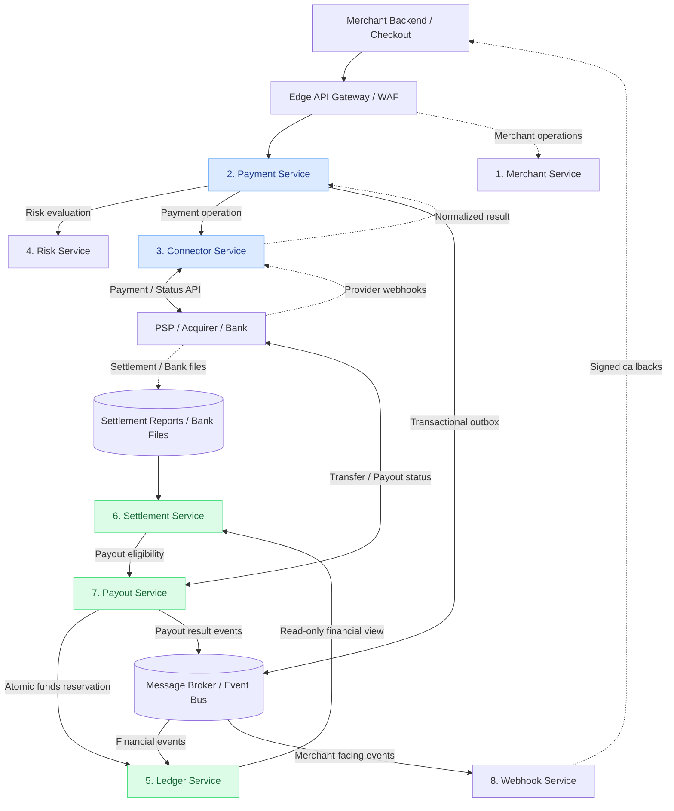
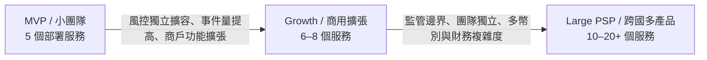
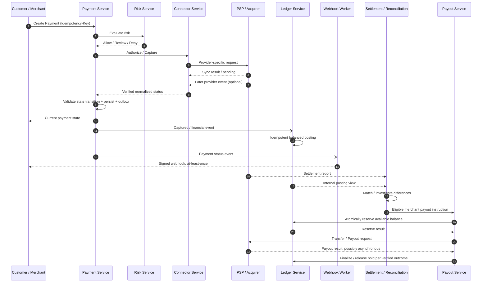

# Payment System Architecture：18 個模組與實際服務拆分

> 目標：設計一套可供多商戶接入、串接多個支付渠道，且能形成交易、帳務、對帳、結算與出款閉環的支付平台。
>
> 適用範圍：以 **Payment Service Provider（PSP）／Payment Gateway 平台** 的工程架構為目標。這是**參考架構與實作建議**，並非任何特定支付公司的官方內部架構，也不代表必須自行承擔收單行、卡組織或銀行的全部職能。

## TL;DR

- **功能視角：6 大領域、18 個模組**；模組是業務能力分類，**不等於** 18 個微服務。
- **邏輯架構：8 個 Bounded Context / 服務邊界**，便於定義責任及資料所有權。
- **第一版部署：5 個 Backend Service**，在程式內保持模組化，按規模和隔離需求再拆到 8 個或更多。
- **最重要的閉環：Payment → Ledger → Reconciliation / Settlement → Payout**。能付款成功不代表完成帳務、結算或商戶出款。
- **從第一版就必須具備**：Idempotency、不可變帳務、可靠事件傳遞、交易狀態機、跨系統對帳、安全隔離與可觀測性。

---

## 1. 完整支付平台的 18 個模組

以下將 18 個功能模組分為 6 大領域。表格中的編號是本文的統一索引。

### A. 商戶與支付接入層

| # | Module | 核心職責 | 典型能力／資料 |
|---|---|---|---|
| **01** | **Merchant Management** | 管理商戶及支付平台合作關係 | 商戶入駐、KYB/KYC 狀態、API Key、RBAC、商戶配置、費率方案 |
| **02** | **Checkout & Payment SDK** | 提供安全、標準化的前端收款體驗 | Hosted Checkout、Payment Link、Web / Mobile SDK、付款方式展示 |
| **03** | **Payment Gateway API** | 對外提供統一支付介面並控制接入流量 | 統一 API、身分驗證、請求驗證、Idempotency Key、Rate Limit |

**重點**：Checkout SDK 多半是前端元件、Hosted Page 或套件，不一定是獨立的 Backend Service。Edge API Gateway 與支付業務 API 也應區分：前者處理接入治理，後者處理交易語意。

### B. 支付交易處理層

| # | Module | 核心職責 | 典型能力／資料 |
|---|---|---|---|
| **04** | **Payment Core / Transaction Engine** | 管理交易的完整生命週期 | Payment Intent、狀態機、Authorize、Capture、Cancel、Payment Attempt |
| **05** | **Payment Orchestration & Routing** | 選擇渠道並處理渠道切換 | 多 PSP 路由、成功率／費率決策、健康檢查、受控 Failover |
| **06** | **Payment Connector / Acquiring Integration** | 對接 PSP、收單機構、銀行等外部支付方 | Provider Adapter、協議轉換、錯誤碼標準化、渠道 Webhook 接收 |
| **07** | **Payment Method & Tokenization** | 管理可用支付方式與付款憑證參照 | 信用卡、銀行轉帳、電子錢包、Payment Method Token、Vault 整合 |

**重點**：Routing 決定「走哪個渠道」，Connector 決定「怎麼跟該渠道溝通」，Payment Core 決定「這筆交易現在處於什麼狀態」。對信用卡敏感資料，優先採用合規 PSP／Token Vault 的 Hosted Fields 或 Tokenization，不自行保存 PAN/CVV。

### C. 風險與交易後處理層

| # | Module | 核心職責 | 典型能力／資料 |
|---|---|---|---|
| **08** | **Fraud & Risk Engine** | 交易風險評估與操作限制 | Velocity Rules、黑名單、Risk Score、3DS/SCA 觸發策略 |
| **09** | **Refund / Void / Dispute** | 處理付款後的退款、撤銷及爭議 | 全額／部分退款、Void、Chargeback、Evidence、爭議狀態 |
| **10** | **Recurring Payments & Billing** | 管理定期收款與帳單 | 訂閱、Invoice、排程扣款、付款失敗重試、Dunning |

**重點**：Void 與 Refund 不同；未請款的授權可能可撤銷，已請款的交易則通常需要退款。Dispute 牽涉更多金融與營運流程，規模成長後可獨立拆分。

### D. 資金與財務核心層

| # | Module | 核心職責 | 典型能力／資料 |
|---|---|---|---|
| **11** | **Ledger & Balance Engine** | 維持平台內部資金帳務真相 | Double-entry Ledger、Account、Posting、Balance、Reserve / Hold |
| **12** | **Clearing & Settlement** | 整理清分資料並處理渠道結算 | Gross/Net Amount、Settlement Batch、Settlement Report、應收應付 |
| **13** | **Reconciliation** | 比對內部紀錄與外部資金資料 | Payment／Ledger／PSP／Bank 對帳、差異、人工調整與補正 |
| **14** | **Payout & Fund Transfer** | 將可出款資金轉入商戶指定帳戶 | 商戶出款、銀行轉帳、Payout Batch、失敗重試、資金預留 |
| **15** | **Fee, Pricing & FX Engine** | 計算平台費用與多幣別價格 | Merchant Fee、PSP Fee、Revenue Share、Exchange Rate、FX Spread |

**重點**：這五個模組最能區分「只會串支付 API」和「理解支付基礎設施」。Ledger 記錄內部應有的帳務，Reconciliation 核對外部事實；Settlement 與 Payout 也不是同一件事。

### E. 事件與平台營運層

| # | Module | 核心職責 | 典型能力／資料 |
|---|---|---|---|
| **16** | **Webhook & Notification** | 將支付狀態可靠通知商戶 | 事件訂閱、簽章、Outbox、Retry、DLQ、Delivery Log |
| **17** | **Reporting & Operations** | 提供商戶與內部的可觀測業務介面 | Dashboard、交易查詢、財務報表、客服後台、操作稽核 |

**重點**：Merchant Webhook 是對外發送的事件；Provider Webhook 是外部 PSP 回傳的事件，接收與校驗通常由 Connector 處理。兩者的驗簽、冪等與信任邊界不同。

### F. 安全與基礎設施層

| # | Module | 核心職責 | 典型能力／資料 |
|---|---|---|---|
| **18** | **Security, Compliance & Reliability** | 橫跨所有服務的安全與穩定性能力 | PCI DSS 範圍控制、Secret/KMS、Audit Log、加密、Tracing、Alerting、DR |

**重點**：#18 是橫切能力，不建議強行包成一個「Security 微服務」。合規義務取決於所在地、資金處理模式、支付資料流和外部合作方的責任分工。

---

## 2. 建議的實際架構：8 個邏輯服務

> 設計原則：以 **Domain Boundary、資料所有權、資金一致性、權限隔離與運維需求** 拆服務，而不是按照上面的 18 個功能名稱一對一拆分。

| 邏輯服務 | 對應模組 | 主要責任 | 資料所有權／邊界 |
|---|---|---|---|
| **1. Merchant Service** | #01、#02、#17（部分） | 商戶管理、設定、商戶 API、Checkout 配置、基本 Dashboard 查詢 | Merchants、API Credentials、Merchant Configuration；SDK 屬於獨立前端交付物 |
| **2. Payment Service** | #03、#04、#09、#10（初期） | Payment Intent、Payment Attempt、狀態機、Capture、Void、Refund、基本 Billing | Payment、Attempt、Refund、Subscription、Invoice；不直接修改 Ledger 帳務 |
| **3. Connector Service** | #05、#06、#07（部分） | 渠道路由、Provider Adapter、渠道狀態查詢、接收渠道通知、Token Ref 使用 | Provider Config、Route Decision、Provider Transaction Reference；敏感卡資料交外部 Vault／合規供應商 |
| **4. Risk Service** | #08 | 交易規則、限額、風控決策、風控事件 | Risk Rule、Risk Decision、Velocity Counter |
| **5. Ledger Service** | #11 | 原子、可稽核的借貸記帳；帳戶及可用餘額 | Accounts、Journal Entries、Postings、Holds；**唯一帳務寫入者** |
| **6. Settlement Service** | #12、#13、#15 | 清分、渠道結算資料、計費、對帳、差異處理 | Settlement Batch、External Statement、Reconciliation Result、Fee Calculation |
| **7. Payout Service** | #14 | 商戶出款排程、審核、資金預留、銀行指令、出款狀態 | Payout、Payout Attempt、Bank Transfer Reference；資金是否足夠由 Ledger 判斷 |
| **8. Webhook Service** | #16 | 訂閱事件、簽署通知、可靠重送、投遞歷史 | Webhook Subscription、Delivery Attempt、Event Payload Reference |

### 18 個模組如何對應？

- #01–#17 均有對應的主要 Owner。#02 中的 **SDK／Hosted Page** 是前端產品，不一定是 Merchant Service 內部的獨立後端程序。
- #07 的 **Vault／卡資料 Tokenization** 可能交由外部合規供應商；Connector 持有 Token Reference，不代表平台必須持有原始卡號。
- #17 中的報表可能在規模成長後拆成專用 **Reporting / Data Pipeline**，避免重查詢拖慢交易資料庫。
- #18 橫跨各服務，透過平台工程、安全治理與合規流程實作，不列入上述 8 個業務服務。
- #09 Dispute、#10 Billing、#15 FX 在業務複雜度增加時，都是可能獨立拆出的候選服務。

### 8 服務邏輯架構圖



**讀圖注意：**

1. 箭頭代表 **API／命令／事件／報表資料**，不是資金直接在微服務之間流動。真正資金移轉依賴收單行、PSP、銀行與清算網路。
2. 圖為邏輯示意，不表示所有 Ledger 事件都適合無條件非同步；例如 Payout 的餘額檢查與預留需要由 Ledger 提供原子操作。
3. 交易結果可能先由同步 API 回傳，也可能晚到 Provider Webhook；最終狀態需要去重、驗證及必要時主動查詢渠道。
4. 不該讓 Connector／Payout 直接改寫 Ledger 資料表；跨服務透過明確 API 或事件完成。

---

## 3. 第一版落地：先部署 5 個 Backend Service

對小團隊而言，我更傾向 **8 個邏輯邊界、5 個實際部署服務**。

| 首版部署服務 | 包含哪些邏輯能力 | 說明 |
|---|---|---|
| **payment-platform** | Merchant + Payment + 基本 Risk + Webhook | 同一個部署單元內分清模組和資料存取層；Webhook 發送使用獨立背景 Worker 與 Queue |
| **connector-service** | Routing + Provider Connectors + Token Reference | Adapter Pattern 串多渠道，不為每一個 PSP 先拆獨立微服務 |
| **ledger-service** | Ledger + Balances + Holds | 單獨保護寫入權限、帳務不變式與交易一致性 |
| **settlement-service** | Clearing + Settlement + Reconciliation + Fees | 同步處理渠道報表、手續費與差異調查；排程 Worker 可獨立擴容 |
| **payout-service** | Payout + Bank Transfer | 出款權限、審核、資金預留、渠道重試與結果追蹤獨立管理 |

### 演進路徑



**不要因為模組數量就直接拆微服務。** 以下情況才值得拆：

- 有清楚的 **Domain Owner 與資料寫入邊界**；
- 需要獨立 Scaling，例如渠道 Webhook 的峰值流量與核心交易 API 差異巨大；
- 有不同權限／合規／故障隔離要求，例如 Payout 與 Ledger；
- 跨團隊獨立開發及部署的收益大於額外的網路、事件、觀測和維護成本。

補充：**5 個 Service ≠ 5 個 Process ≠ 5 個資料庫 Instance**。例如 `settlement-service` 可能同時有 API、報表匯入 Worker、排程對帳 Worker，但仍是同一個業務服務邊界。各服務可共用 PostgreSQL Cluster 以節省成本，惟應採用各自的 Schema／資料所有權與獨立寫入權限，不允許跨服務直接修改別人的資料。

---

## 4. 一筆支付的完整生命週期

以卡片支付為例，簡化為以下流程；實際狀態依支付方式及 Provider 而不同。



### 三種不同的「成功」

| 事件 | 意義 | 不代表什麼 |
|---|---|---|
| **Payment Captured / Succeeded** | 支付處理端確認已完成相應請款／支付操作 | 不代表商戶已收到銀行入帳 |
| **Settled** | 已依渠道／銀行的結算語意完成對應結算流程 | 不代表平台已把錢出給商戶 |
| **Paid Out** | 平台已發起並完成對商戶的出款；完成與否應以銀行／渠道可驗證的最終狀態為準 | 不代表所有退款／爭議風險都已消失 |

**會計政策注意：** 何時入 Ledger 的哪個 Account（授權、請款、應收、待結算、可用餘額等），要依平台的資金模式與會計模型定義，不能把 `authorize` 當成 `cash settled`；也不能假設每筆 `captured` 都可立即出款。

---

## 5. 核心服務的邊界與設計重點

### 5.1 Payment Core — 掌握狀態，不直接改資金帳

- 對外使用 `payment_id`，對渠道使用 `provider_transaction_id`，分開存放。
- 建議獨立 `PaymentIntent`、`PaymentAttempt`、`Refund` 等概念；同一 Payment 可能有多次 Attempt，但**不應對不確定結果盲目重送至不同渠道**。
- 狀態更新必須由受控的 State Machine 執行，拒絕過期、亂序或非法轉移。
- 支援 `authorize`、`capture`、`partial_capture`（依渠道能力）、`void`、`refund`，並且明確區分同步成功、非同步成功與未知結果。
- 商戶送相同 `Idempotency-Key` 且請求參數相同時回傳一致結果；相同 Key 對應不同參數則報錯。實際應定義 Key 的作用域、TTL 和重放契約。

### 5.2 Connector — 隔離各家 PSP 的差異

建議目錄結構：

```text
connector-service/
├── routing/                 # Routing rules, health, cost
├── providers/
│   ├── stripe/
│   ├── adyen/
│   └── paypal/
├── normalization/           # Canonical status / error model
├── webhooks/                # Provider signature verification
├── reconciliation_adapters/# Provider settlement/report parsers
└── token_references/        # Reference to compliant token vault
```

- Provider Adapter 處理渠道特定 API、timeout、簽章、錯誤碼與狀態映射。
- 先使用單一 Connector Service；除非某渠道有獨立安全需求、流量瓶頸或服務品質要求，否則不要每個 PSP 都建一個微服務。
- **Timeout ≠ Payment Failed**：Timeout 可能代表 Provider 已成功處理但回應丟失。先查詢渠道狀態並使用其冪等機制，避免跨渠道雙重扣款。
- Merchant Webhook 和 Provider Webhook 必須分別建模：前者可靠對外投遞；後者安全驗簽及正規化後才驅動 Payment 狀態更新。

### 5.3 Ledger — 金融帳務的唯一寫入入口

最小能力：

- Double-entry Posting：每一筆 Journal Transaction 的借貸總額必須相等，並在同一資料庫交易內原子完成。
- Immutable Journal：已入帳資料不直接修改；錯誤透過沖銷／調整分錄處理。
- `source_event_id`／`business_reference` 去重；避免事件重播造成重複入帳。
- 支援 Account、Postings、Balances、Holds/Reservations；可用餘額的計算語意需明確。
- 跨服務只能經由 Ledger API／事件交互；不能由 Payment、Settlement、Payout 自行更新 Ledger Tables。

**Ledger 是帳務事實來源，不等於銀行實際餘額的唯一真相**；與銀行／PSP 的差異仍須依靠 Reconciliation 發現並處理。

### 5.4 Settlement & Reconciliation — 建立資金閉環

典型輸入：

1. 平台的 Payment／Refund／Ledger 紀錄。
2. PSP Settlement Reports、Fees、Chargebacks。
3. 銀行入帳／出帳檔案，視資金模式而定。

典型輸出：

- `matched`、`missing_internal`、`missing_external`、`amount_mismatch`、`fee_mismatch`、`pending` 等差異分類。
- 針對不同來源、時間窗、時區、幣別、手續費、分批結算的比對規則。
- 以人工覆核／核准工作流處理需要調帳的問題，而不是自動偷偷修改 Ledger。
- 達到條件後產生商戶可出款金額與結算批次，並留下可追查的來源關係。

### 5.5 Payout — 避免出款雙花與狀態誤判

- 出款前透過 Ledger **原子預留／扣減**可用資金，避免兩個並發出款都通過餘額檢查。
- 出款請求、銀行／PSP 交易參照、Payout Attempt 與結果獨立追蹤。
- 網路斷線時不可直接重複送出一筆新轉帳；先根據外部 Transfer ID 和冪等規則查詢結果。
- 只有確認最終失敗才能釋放預留；未知結果要保持 Pending／Investigating 狀態。
- 高金額或敏感受款帳戶變更可加入 Approval Workflow、雙人覆核與額外審計。

---

## 6. 分散式系統的必備可靠性設計

| 問題 | 建議作法 | 為什麼 |
|---|---|---|
| **API 重送** | 商戶與渠道兩層 Idempotency；唯一索引、請求指紋 | 防止重複建單與扣款 |
| **DB 已提交但事件沒發出去** | Transactional Outbox + Background Publisher | 避免業務狀態與事件永遠不一致 |
| **事件重複與亂序** | Inbox / Consumer Dedup + Version / State Transition Check | Broker 通常無法提供整條鏈路的 Exactly-once Side Effect |
| **PSP 逾時但實際已扣款** | Unknown / Pending 狀態 + Provider Query / Webhook | 避免把未知誤認為失敗並造成二次扣款 |
| **外部渠道故障** | Timeout、Circuit Breaker、Rate Limit；只在安全語意下 Retry / Failover | 限制故障擴散及重複交易風險 |
| **退款、拒付與入帳交錯** | 單一業務鍵序列化／版本控制、原子 Ledger Posting、補償分錄 | 保持狀態及帳務一致 |
| **出款併發** | Atomic Reservation / Balance Constraint | 防止資金被重複出款 |
| **帳務與渠道數據不一致** | T+N 對帳、差異佇列、補帳審批、完整 Audit Trail | 跨系統的最後一道安全網 |
| **Webhook 交付失敗** | 帶簽章通知、Exponential Backoff、DLQ、Replay | 商戶端短暫不可用不應造成事件永久丟失 |
| **事件和交易追蹤困難** | Correlation ID、Payment ID、Provider Ref、Trace ID | 跨服務重建單筆交易事件時間線 |

### 建議的資料模型（最小集合）

```text
Merchant: merchant_id, status, config, credential_reference
Payment: payment_id, merchant_id, amount, currency, status, version
PaymentAttempt: attempt_id, payment_id, provider, provider_reference, status
Refund: refund_id, payment_id, amount, status, provider_reference
LedgerAccount: account_id, owner_id, currency, account_type
LedgerTransaction: journal_id, source_event_id, status
LedgerPosting: posting_id, journal_id, account_id, direction, amount
SettlementBatch: batch_id, provider, currency, period, status
ReconciliationItem: item_id, source_reference, match_status, difference
Payout: payout_id, merchant_id, amount, currency, status, bank_reference
OutboxEvent: event_id, aggregate_id, event_type, payload, published_at
WebhookDelivery: delivery_id, event_id, merchant_id, status, attempt_count
```

此表為概念模型，實務上還需要關聯約束、幣別精度、不可變策略、事件版本、審計欄位與個資隔離；金額應使用**最小貨幣單位整數**或明確精度的 Decimal，避免浮點數誤差。

---

## 7. 安全、合規與日常營運（#18）

**安全不能等到架構最後才補：**

- **支付資料最小化**：避免自行接觸原始卡號及 CVV；若處理卡資料，根據實際資料流評估 PCI DSS 範圍及控制措施。
- **存取權限**：商戶 API Key／OAuth／RBAC／Scope，分隔商戶資料；Payout／Ledger 採更嚴格的服務間授權。
- **Secret & Cryptography**：KMS、Secret Rotation、TLS、Webhook HMAC / Provider Signature Verification；敏感資料加密儲存。
- **Auditing**：高權限操作、風控規則變更、商戶出款帳戶更新及調帳需可追溯。
- **可觀測性**：按渠道統計授權成功率、拒絕率、延遲、Webhook Lag、Ledger Posting Lag、對帳差異率與出款失敗率。
- **復原能力**：備份及還原演練、RPO/RTO 定義、DLQ Replay、渠道停用、災難復原、故障演練。
- **法規分工**：若要實際保管客戶資金、跨境匯兌或提供出入金，須先確認法域中的牌照、AML/KYC、制裁篩查、資金隔離及合作銀行要求；純技術整合平台不能直接假設具備這些權限。

---

## 8. 建議實作階段與驗收標準

| 階段 | 實作重點 | 可驗證成果 |
|---|---|---|
| **P0 — Payment Core** | Merchant / Gateway、Payment Core、單一 Connector、基本 Risk、退款、Webhook、初版 Ledger | Sandbox 完成建單、授權、請款、退款；相同 Idempotency Key 不重複扣款與記帳；Webhook 重送不造成狀態倒退 |
| **P1 — Financial Loop** | 完整 Ledger、清分結算、渠道對帳、費用計算、Payout | 從支付追蹤至 Ledger→Settlement→Payout；刻意製造漏單／費率差異，能準確偵測與追查；並發出款不能超領 |
| **P2 — Platform Capabilities** | 多渠道 Routing、Billing、Dispute、進階風控、Reporting、FX | 模擬渠道故障可安全恢復；跨幣別費用可稽核；能產出商戶結算報表與完整交易時間線 |

### 必測故障場景

1. 商戶以同一 Idempotency Key 送出 100 次並發支付請求。
2. Provider 已完成交易但 Connector 遇到 Timeout；系統保持未知狀態，最終收斂且無二次扣款。
3. Provider Webhook 重複、亂序、晚到，不能造成非法狀態轉移或重複入帳。
4. Payment 成功寫入 DB，但 Event Broker 暫時故障；Outbox 最終補送。
5. 部分退款與結算報表同時到達，Ledger 與商戶餘額正確。
6. PSP 報表缺少一筆、手續費不符或跨批次結算，Reconciliation 可以定位差異。
7. 兩筆並行 Payout 分別嘗試領走相同可用餘額，最多只能成功預留允許的金額。
8. Payout 傳送後網路斷線，不能在結果未知時重送成另一筆出款。

---

## 9. 架構決策摘要（Architecture Decision Records）

| 決策 | 初期選擇 | 何時重新評估 |
|---|---|---|
| 服務數量 | **5 個部署 Service、8 個邏輯邊界** | 組織、吞吐量、安全隔離或部署節奏產生明確瓶頸 |
| Payment / Ledger | **分離資料寫入責任** | 原則上不合併金融帳務的資料所有權 |
| PSP 接入 | **單一 Connector Service + 多個 Adapter** | 個別渠道獨立的高流量／隔離／合規需求出現 |
| Settlement / Reconciliation | **初期合併** | 對帳資料量、財務團隊、監管報表和結算規則顯著複雜化 |
| Payout | **獨立 Service** | 從起步就有獨立出款風險與權限邊界 |
| Risk / Webhook | **初期作為獨立模組與 Worker** | 風控延遲、投遞量及團隊責任需要獨立擴容時 |
| 資料庫 | **可共用 Cluster，但不可共用表格寫入權** | 安全、容量、備援或法規需要時改為獨立 Instance |
| 跨服務一致性 | **本地 ACID + Outbox / Inbox + Idempotency + Reconciliation** | 不以跨服務分散式 ACID Transaction 作為預設方案 |

### 延伸閱讀（官方文件入口）

- [Stripe — Payment Intents API](https://docs.stripe.com/api/payment_intents)：交易生命週期與狀態。
- [Stripe — Idempotent Requests](https://docs.stripe.com/api/idempotent_requests)：支付 API 的冪等設計。
- [Adyen — Payments Lifecycle](https://docs.adyen.com/account/payments-lifecycle/)：收款、結算及出款流程。
- [Modern Treasury — Ledgers](https://docs.moderntreasury.com/ledgers/docs/overview)：資金帳務模型。
- [PCI Security Standards Council](https://www.pcisecuritystandards.org/)：支付卡資料安全標準。

---

**最終建議：** 不必為了完整性把 18 個模組拆成 18 個服務。先把 **Payment 的交易狀態、Connector 的外部渠道差異、Ledger 的帳務真相，以及 Settlement / Reconciliation / Payout 的資金閉環** 做正確，再根據實際需求拆服務。對支付系統而言，資料正確性、可稽核性與故障後可恢復性，比微服務數量重要得多。
