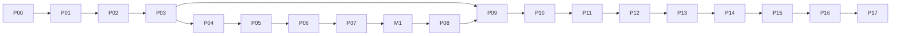

# Payment 實踐計劃：總覽

> 目標：用一連串很小的迭代，親手做完 [`payment-system-architecture.md`](../payment-system-architecture.md) 的 18 個模組，並在過程中理解每個設計為什麼存在。
>
> 技術棧：Go、PostgreSQL、Redis、RabbitMQ、React/Next.js、Docker Compose、OpenTelemetry、Prometheus/Grafana、k6。

## 1. 這套文件怎麼用

| 文件 | 用途 |
|---|---|
| `00-overview.md`（本檔） | 原則、階段總表、模組對照、範圍、repo 與 commit 規則 |
| [`01-iteration-template.md`](./01-iteration-template.md) | 每次迭代、學習筆記、ADR、階段檢核的固定格式 |
| [`02-architecture-evolution.md`](./02-architecture-evolution.md) | Monolith 的邊界規則、第三方 adapter 規則、何時抽出服務、何時拆 repo |
| [`03-design-patterns.md`](./03-design-patterns.md) | 系統設計模式目錄：解決什麼、在哪次迭代學、何時不要用；PSP 抽象的分層 |
| `phases/*.md` | 每個階段一份，逐次列出迭代 |
| [`appendix-survey-keywords.md`](./appendix-survey-keywords.md) | 各階段 survey 關鍵字、官方文件入口、第三方 sandbox 注意事項 |

每次開始一次迭代：

1. 打開該階段文件，只讀這一次迭代。
2. 先回答「先想清楚」的問題，寫進學習筆記。需要時查附錄的關鍵字。
3. 把設計決定寫下來（重要的寫成 ADR），再開始寫程式。
4. 先寫會失敗的測試，再實作到通過。
5. 達成「完成條件」才算結束。做不完就把剩下的部分拆成下一次，不要把迭代撐大。

## 2. 原則

- **一次只證明一件事。** 每次迭代 2–4 小時，只處理一個概念或一個不變量，並附上測試。
- **先做對，再做多。** 資金正確性（不重複扣款、帳平衡、不超額出款）永遠優先於功能數量。
- **不確定就說不確定。** 外部結果未知時保持 `UNKNOWN`，不要猜成功或失敗。
- **證據優先。** 每次迭代都要留下可以重跑的測試、可以查證的 provider reference、或可以重現的故障紀錄。
- **Monolith 先，服務後。** P00–P16 都是一個 API 行程加一個 Worker 行程；P17 才抽出服務。
- **只用 Mock 壓測。** 不對真實 PSP 或 vendor 的 sandbox 做大量請求。

## 3. 如何使用 AI

目的是讓你理解每個模組，所以 AI 的角色要受限：

- **可以**：解釋這次迭代涉及的概念、幫你檢查你寫的設計有沒有漏洞、審查你寫完的程式、解釋錯誤訊息。
- **盡量避免**：一次請 AI 產生整個模組，或跨越多次迭代的程式碼。
- **規則**：設計決定由你自己先寫進學習筆記或 ADR，再請 AI 審查。若 AI 產生了程式碼，你要能逐行解釋它在防什麼問題，否則這次迭代不算完成。
- **建議的提問方式**：「我在做 I-03.03，我的設計是 …，在 100 個並發相同 key 請求下會出什麼問題？」而不是「幫我做 idempotency」。

## 4. 階段總表

迭代編號格式是 `I-<階段>.<序號>`，例如 `I-05.03`。M1 的迭代編號是 `I-M1.01`。後來插入的迭代用字母後綴，例如 `I-02.05a`，不重新編號。

| 階段 | 主題 | 對應模組 | 迭代數 | 累計 |
|---|---|---|---:|---:|
| [P00](./phases/p00-foundation.md) | 基礎建設 | #18（基礎部分） | 10 | 10 |
| [P01](./phases/p01-merchant-gateway.md) | 商戶與 Gateway API | #01、#03 | 12 | 22 |
| [P02](./phases/p02-payment-core.md) | Payment Core 與 Stripe | #04、#06 | 15 | 37 |
| [P03](./phases/p03-reliability.md) | 可靠性 | #03、#06 | 13 | 50 |
| [P04](./phases/p04-refund-void.md) | 退款與取消 | #09（第一部分） | 6 | 56 |
| [P05](./phases/p05-ledger.md) | Ledger | #11 | 13 | 69 |
| [P06](./phases/p06-settlement-reconciliation.md) | 結算、對帳、手續費 | #12、#13、#15（手續費） | 14 | 83 |
| [P07](./phases/p07-payout.md) | Payout | #14 | 9 | 92 |
| [M1](./phases/m1-portfolio.md) | 作品集整理 | — | 4 | 96 |
| [P08](./phases/p08-onboarding-compliance.md) | 商戶入駐與合規 | #01（KYB/KYC）、#18（合規） | 10 | 106 |
| [P09](./phases/p09-merchant-webhooks.md) | 商戶出站 Webhook | #16 | 8 | 114 |
| [P10](./phases/p10-risk.md) | Risk | #08 | 8 | 122 |
| [P11](./phases/p11-checkout-payment-methods.md) | Checkout 與支付方式 | #02、#07 | 11 | 133 |
| [P12](./phases/p12-orchestration.md) | 多渠道編排 | #05 | 9 | 142 |
| [P13](./phases/p13-billing.md) | Billing | #10 | 11 | 153 |
| [P14](./phases/p14-dispute-fx.md) | Dispute 與 FX | #09（第二部分）、#15 | 9 | 162 |
| [P15](./phases/p15-reporting-operations.md) | 報表與營運 | #17 | 9 | 171 |
| [P16](./phases/p16-security-reliability.md) | 安全與可靠性收尾 | #18 | 9 | 180 |
| [P17](./phases/p17-service-extraction.md) | 抽出服務 | 架構文件第 2–3 節 | 14 | 194 |

**總數約 194 次迭代。** 撰寫計劃時估的是 175 次，逐次排完後是 190 次；之後為了多 PSP 的介面分層、渠道註冊與商戶渠道帳號、connector decorator、ledger 熱點帳戶，又加了 4 次（I-02.05a、I-02.05b、I-03.06a、I-05.11a）。

### 時間估算

| 每週投入 | 到 M1（96 次） | 到 P16（180 次） | 全部（194 次） |
|---|---|---|---|
| 10 小時 | 約 29 週 | 約 54 週 | 約 58 週 |
| 15 小時 | 約 19 週 | 約 36 週 | 約 39 週 |
| 20 小時 | 約 14 週 | 約 27 週 | 約 29 週 |

以每次平均 3 小時估算。這比 [`ProjectRoadmap.md`](../ProjectRoadmap.md) 的 9 週長很多，因為這裡每一步都要求理解並留下證據。

### 依賴關係



P00–P07 必須照順序做。M1 之後的階段大多可以調換，但建議照表上的順序，因為後面的階段會重用前面的元件（例如 P13 會用到 P09 的事件與 P11 的已存支付方式）。

## 5. 18 個模組對照

| # | 模組 | 主要迭代 | 補充迭代 |
|---|---|---|---|
| 01 | Merchant Management | I-01.01–01.05 | P08 全部、I-06.11（費率方案）、I-15.01–15.02 |
| 02 | Checkout & Payment SDK | I-11.01–11.05 | I-02.08（最小 3DS 頁面） |
| 03 | Payment Gateway API | I-01.03–01.12 | I-03.01–03.03（冪等） |
| 04 | Payment Core | I-02.01–02.12 | I-03.06–03.07（UNKNOWN 與 recovery） |
| 05 | Orchestration & Routing | P12 全部 | I-02.05b（Router 介面與固定路由） |
| 06 | Connector | I-02.05–02.13（含 I-02.05a、I-02.05b） | I-03.04–03.10（含 I-03.06a）、I-12.01–12.02 |
| 07 | Payment Method & Tokenization | I-11.05–11.11 | I-13.01–13.02 |
| 08 | Fraud & Risk | P10 全部 | — |
| 09 | Refund / Void / Dispute | P04 全部、I-02.11 | I-14.01–14.04 |
| 10 | Recurring & Billing | P13 全部 | — |
| 11 | Ledger & Balance | P05 全部（含 I-05.11a） | I-06.09、I-07.03–07.06 |
| 12 | Clearing & Settlement | I-06.01–06.04 | I-06.13–06.14 |
| 13 | Reconciliation | I-06.05–06.09 | I-06.13–06.14、I-11.11 |
| 14 | Payout | P07 全部 | I-08.08 |
| 15 | Fee, Pricing & FX | I-06.10–06.12 | I-14.05–14.09 |
| 16 | Webhook & Notification | P09 全部 | — |
| 17 | Reporting & Operations | P15 全部 | — |
| 18 | Security, Compliance & Reliability | P16 全部、P00 | P08、I-01.11、I-11.07 |

架構文件第 6 節的可靠性需求對照：

| 問題 | 對應迭代 |
|---|---|
| API 重送 | I-03.01–03.04 |
| DB 已提交但事件沒發出去 | I-03.11–03.12 |
| 事件重複與亂序 | I-03.09–03.10、I-05.07 |
| PSP 逾時但實際已扣款 | I-03.05–03.07 |
| 外部渠道故障 | I-03.06a、I-12.05–12.08 |
| 退款、拒付與入帳交錯 | I-04.03、I-14.02、I-05.11 |
| 出款併發 | I-05.11、I-07.03 |
| 帳務與渠道數據不一致 | P06 |
| Webhook 交付失敗 | I-09.05–09.07 |
| 事件和交易追蹤困難 | I-00.09、I-01.06、I-15.03、I-17.11 |

## 6. 第三方整合原則

有些能力不可能也不應該自己做，例如身分辨識、制裁名單資料、匯率、卡資料保管。這些都接第三方，你自己做的是**流程、狀態機、資料保存邊界與失敗處理**。

- 每個第三方都包一層 adapter，並有 Mock 版本。本機與自動化測試只跑 Mock；sandbox 只做少量端到端驗證。
- 第三方回應多半是非同步 webhook，重用 P03 的驗簽、inbox、去重。
- 只保存 vendor 的 reference 與結果，不保存證件影像與完整個資。個資欄位加密，並記錄誰存取過。
- 結果不確定或 vendor 故障時，預設不放行（fail closed），轉人工處理。
- Vendor 的分數或建議是輸入，最終決策由你自己的規則做出並留下紀錄。

| 能力 | 階段 | 候選（只當 survey 起點） |
|---|---|---|
| 支付處理 | P02、P12 | Stripe（主）、Adyen 或 PayPal（第二家） |
| KYB（商戶公司驗證） | P08 | Stripe Connect onboarding、Middesk、Sumsub |
| KYC（負責人、受益人身分） | P08 | Stripe Identity、Persona、Sumsub、Onfido |
| 制裁與 PEP 篩查 | P08 | ComplyAdvantage、OpenSanctions |
| 商戶銀行帳戶驗證 | P08 | Plaid Auth、Stripe Financial Connections、自製 Mock 微額驗證 |
| 通知郵件 | P09 | Mailpit（本機） |
| 外部風險評分 | P10 | Stripe Radar 結果、Sift |
| 卡資料保管 | P11 | PSP 的 hosted fields（Stripe Payment Element） |
| 匯率來源 | P14 | ECB 每日參考匯率、Open Exchange Rates |
| Secret 與 KMS | P16 | HashiCorp Vault、SOPS、LocalStack KMS |

實際選哪一家，以「能否免費申請 sandbox、所在地區能否使用」為準，並把選擇理由寫成 ADR。

## 7. 範圍

### 明確不做

- 取得牌照、自建收單或卡組織連線
- 自建卡號 vault、PCI Level 1 認證
- 真實資金移動、用真人身分跑 KYC
- 稅額計算、加密貨幣與 stablecoin
- 原生行動 SDK（iOS / Android）；需要時以 hosted checkout 的行動網頁代替

### 證據要分清楚

報告與 README 裡要區分「自動化測試通過」「在 sandbox 人工驗證」「只有設計、尚未實作」三種狀態。不要把 Mock 的效能數字說成 PSP 的 SLA。

## 8. 與 ProjectRoadmap 的關係

[`ProjectRoadmap.md`](../ProjectRoadmap.md) 是以找工作為目標的 9 週版本。本計劃是它的細化與延伸：

| ProjectRoadmap | 本計劃 |
|---|---|
| W1 Gateway & Secure Checkout | P00、P01、I-02.08（最小結帳頁）；完整 checkout 在 P11 |
| W2 Card Payment Lifecycle + 3DS | P02、P04 |
| W3 Reliability | P03 |
| W4 Double-entry Ledger | P05 |
| W5 Reconciliation | P06 |
| W6 Multi-PSP | 介面在 I-02.05a–02.05b 就以多家為前提設計；真正接第二家與路由在 P12（刻意延後，理由見 P12 文件） |
| W7 Marketplace & Payout | I-06.10–06.12、P07 |
| W8 Security / Risk | P08、P10、P16 |
| W9 Benchmark & 面試包裝 | M1、I-16.09 |

**找工作的分界：** 做完 M1 就可以開始投履歷。做完 P08 再投，可以多講一段入駐與合規。

ProjectRoadmap 引用的 `Payment_Engineering_Reading_Resources.md` 目前不存在，閱讀資源改由 [`appendix-survey-keywords.md`](./appendix-survey-keywords.md) 按階段提供。

## 9. Repo 與版本管理

### 目錄（P00 建立，之後逐步填入）

```text
payment-infrastructure-lab/
├── cmd/
│   ├── api/
│   └── worker/
├── internal/
│   ├── platform/        # db、config、log、otel、idempotency、outbox、inbox
│   ├── merchant/
│   ├── payment/
│   ├── connector/       # stripe、mock、之後加第二家
│   ├── refund/
│   ├── ledger/
│   ├── settlement/      # 結算、對帳、手續費
│   ├── payout/
│   ├── onboarding/      # P08
│   ├── webhook/         # P09 出站通知
│   ├── risk/            # P10
│   ├── checkout/        # P11
│   ├── billing/         # P13
│   ├── dispute/         # P14
│   ├── fx/              # P14
│   └── ops/             # P15
├── web/
│   ├── checkout/        # Next.js，P02 最小頁面，P11 完整
│   └── dashboard/       # Next.js，P15
├── migrations/<module>/
├── tools/mockpsp/       # P03
├── deploy/compose/
├── docs/
│   ├── adr/
│   ├── notes/           # 每次迭代的學習筆記
│   └── evidence/        # 故障場景與測試輸出
├── roadmap/
└── Makefile
```

### 前端先以 Mock 存在

`web/checkout` 與 `web/dashboard` 的 React 頁面已經先做好，預設讀 Mock 資料。之後對應的迭代改接 `API_MODE=live` 的 client，不重做頁面。金額、付款結果與權限仍以後端為準。

### 分支、commit、tag

- 一次迭代一個分支：`iter/I-05.03-journal-balance`。
- 一次迭代一個 PR（自己審也要開），PR 描述貼上完成條件的證據。
- Commit 訊息以迭代編號開頭：`I-05.03: reject unbalanced journal per currency`，內文寫「為什麼」。
- 不使用 `--no-verify`，不關掉測試。
- 每個階段結束打 tag：`p05-ledger-done`。
- 合併前必須通過 CI（lint、測試、安全掃描）。

### Repo 何時拆

細節見 [`02-architecture-evolution.md`](./02-architecture-evolution.md)。摘要：

- P00–P16：單一 monorepo、單一 Go module。
- P11：只有在把 checkout 做成可安裝的 SDK 時，才拆出 SDK repo。
- P17：同一個 repo 改成 `go.work` 多 module，仍然不拆。
- P17 之後選做：部署與基礎設施程式碼拆成 `payment-infra` repo。
