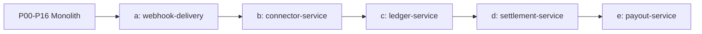

# 架構演進：從 Modular Monolith 到 5 個服務

這份文件回答三個問題：

1. Monolith 階段要守哪些規則，之後才抽得出來？
2. 什麼時候、按什麼順序把模組抽成服務？
3. Repo 什麼時候要拆，什麼時候不要拆？

## 1. 演進時間線

| 階段 | 行程 | 基礎設施 | 架構狀態 |
|---|---|---|---|
| P00 | api、worker（空） | Postgres、OTel collector、Prometheus、Grafana | 目錄與邊界規則就位 |
| P01 | api | 加 Redis（rate limit） | 第一個模組：merchant |
| P02 | api | 加 Next.js 最小結帳頁 | payment、connector |
| P03 | api、worker | 加 Mock PSP | outbox、inbox、recovery；worker 開始有工作 |
| P05 | api、worker | — | ledger 是唯一帳務寫入者 |
| P06 | api、worker | — | settlement 只讀 ledger，調整走 ledger API |
| P07 | api、worker | 加 Mock 銀行 | payout 透過 ledger 的同步 hold |
| P09 | api、worker | 加 RabbitMQ、Mailpit | outbox dispatcher 改發到 RabbitMQ |
| P11 | api、worker | Next.js 完整 checkout | — |
| P15 | api、worker | Postgres 讀副本（選做） | 報表 read model |
| P16 | api、worker | Vault 或 SOPS | 每個模組獨立 DB role |
| P17 | 5 個服務 | gRPC 或 HTTP、多個 DB role 或 DB | 架構文件第 3 節的 5 個部署服務 |

### 為什麼 RabbitMQ 延到 P09 才引入

P03 的 outbox dispatcher 只在同一個 Postgres 裡用 `FOR UPDATE SKIP LOCKED` 輪詢，worker 直接消費。理由：

- 這樣你會先看清楚 outbox 本身解決什麼問題（狀態和事件同一個資料庫交易），不會和 broker 的語意混在一起。
- P09 的商戶 webhook 才真的需要 broker 能力：多個消費者、延遲重試、DLQ。
- 引入時要寫一份 ADR，比較「DB 輪詢」與「broker」的取捨。

## 2. Monolith 階段的邊界規則

從 P00 開始遵守。違反任何一條，P17 就要付出代價。

### 2.1 程式碼邊界

- 每個模組一個 Go package：`internal/<module>`。
- 模組對外只暴露一個公開介面檔，例如 `internal/ledger/api.go`，裡面是介面與 DTO。其他模組只能 import 這一層。
- 模組內部實作放在 `internal/<module>/internal/...`，Go 編譯器會阻止其他模組 import。
- 用 import 檢查工具（例如 depguard 或 go-arch-lint）在 CI 擋住違規依賴。
- `internal/platform` 只放與業務無關的東西（DB、log、otel、config、outbox、inbox、idempotency）。不可以把業務邏輯丟進去。

### 2.2 資料邊界

- 每個模組使用自己的 Postgres schema：`merchant.*`、`payment.*`、`ledger.*` …
- **只有擁有者能寫自己的 schema。** 跨模組要讀資料時，P05 之前可以透過對方的公開介面查詢；不可以直接 JOIN 別人的表來寫業務邏輯。
- 報表例外：P15 的 read model 可以讀多個 schema，但只讀不寫，而且放在 `ops` 模組。
- P16 會把這條規則從「約定」變成「權限」：每個模組一個 DB role，只對自己的 schema 有寫入權。

### 2.3 模組之間怎麼溝通

| 情況 | 方式 | 例子 |
|---|---|---|
| 需要立即知道結果，且失敗要讓呼叫端知道 | 同步介面呼叫 | payment 呼叫 risk 拿決策；payout 呼叫 ledger 建 hold |
| 狀態改變後，其他模組要跟著做事 | outbox 事件 | payment captured → ledger 過帳、webhook 通知商戶 |
| 外部來的事件 | inbox | Stripe webhook、KYC vendor webhook |

規則：

- 跨模組的同步呼叫**不能**放在同一個資料庫交易裡完成兩邊的寫入。如果需要兩邊一起成功，表示邊界畫錯了，或者應該改用事件。
- 唯一例外是 payout 預留餘額：payout 同步呼叫 ledger 的 hold API，ledger 在自己的交易裡原子完成檢查與預留。payout 自己的狀態另外寫，並以 hold id 關聯。

### 2.4 第三方 adapter 規則

- 每個外部依賴（PSP、KYC vendor、制裁篩查、匯率、郵件、KMS）都有一個介面和至少兩個實作：真實 sandbox 版與 Mock 版。
- 介面回傳的是你自己的領域結果（例如 `Approved / Rejected / NeedsInfo / Unknown`），不是 vendor 的原始格式。原始回應另外保存供除錯。
- 每個外部呼叫都要設定 timeout，並把「逾時」和「明確失敗」分開回傳。
- 外部呼叫不能放在資料庫交易裡。順序是：先寫意圖（pending）→ 提交 → 呼叫外部 → 寫結果。
- 本機與 CI 只跑 Mock；sandbox 測試標記為手動或夜間執行。
- PSP 這一類有多家實作的依賴，另外有 Router、Registry、decorator 鏈與共用的 conformance 測試，分層見 [`03-design-patterns.md`](./03-design-patterns.md) 第 2 節。

## 3. 抽出服務

### 3.1 為什麼等到 P17

- 在 monolith 裡，資金一致性可以靠一個資料庫交易保證。先把正確性做對，你才知道抽出後失去了什麼。
- 所有模組都存在之後，你才看得到真實的依賴圖，而不是猜的。
- 抽出本身就是一門課：網路失敗、跨服務冪等、資料遷移、契約版本。把它集中在一個階段學，比每個模組都半途拆一次清楚。

### 3.2 抽出順序與理由

順序從風險最低的開始：

| 順序 | 服務 | 包含模組 | 觸發條件（為什麼值得獨立） | 為什麼排這個順序 |
|---|---|---|---|---|
| a | webhook-delivery | webhook（出站） | 商戶端點慢或掛掉時，投遞重試會佔用 worker；需要獨立擴容 | 只消費事件、不擁有資金資料，抽錯了也不會算錯錢 |
| b | connector-service | connector、routing、token reference | 外部 I/O、timeout、PSP 憑證需要和核心隔離 | 介面在 P02 就定好，已有契約測試；練習網路邊界上的冪等 |
| c | ledger-service | ledger | 帳務不變量與寫入權限需要最嚴格的保護 | 風險最高，放在已經熟悉抽出流程之後 |
| d | settlement-service | settlement、reconciliation、fee | 批次匯入與對帳 job 會拖慢交易資料庫 | 只讀 ledger，調整走 ledger API，c 完成後才乾淨 |
| e | payout-service | payout | 出款權限、審核、銀行憑證需要獨立 | 依賴 ledger 的同步 hold API，最後做 |

剩下的 merchant、payment、risk、refund、onboarding、billing、dispute、fx、ops 留在 `payment-platform`，對應架構文件第 3 節的第一個部署服務。

### 3.3 每次抽出的固定步驟

1. **盤點**：列出該模組被誰呼叫、呼叫誰、擁有哪些表、發出與消費哪些事件。
2. **確認前置條件**（下一節）。
3. **行程內改成 client**：呼叫端改用一個 client 介面，實作暫時仍是行程內呼叫。所有測試必須仍然通過。
4. **定義契約**：proto 或 OpenAPI 放進 `contracts/`，加上 breaking change 檢查。
5. **加上網路實作**：client 改成 gRPC 或 HTTP。補上 timeout、重試、冪等 key 傳遞、錯誤對應。
6. **拆部署**：新服務有自己的 `cmd/`、Dockerfile、DB role。
7. **資料搬遷**：若改用獨立 DB，使用 expand / contract，不停機搬。
8. **故障測試**：在兩個服務之間注入延遲、斷線、重複請求。
9. **寫 ADR**：抽出的理由、代價、何時考慮合回去。

### 3.4 抽出的前置條件

- 該模組的表全部在自己的 schema，且只有它自己寫。
- 沒有其他模組直接 JOIN 它的表（P15 的報表 read model 除外，抽出前要改成事件或 API）。
- 模組公開介面已有契約測試。
- 事件都經過 outbox，消費端都有 inbox 去重。
- 有 trace 可以看到一個請求穿過這個模組。

### 3.5 要學的取捨

- **網路失敗不再是罕見情況。** 原本的函式呼叫變成可能逾時的請求，呼叫端要區分「沒送到」「送到但不知道結果」「明確失敗」。
- **冪等要穿過網路。** 例如 payment 呼叫 connector-service 時，必須傳遞 attempt 級的冪等 key，connector-service 再傳給 PSP。
- **Payout 預留為什麼必須同步。** 如果 payout 用事件通知 ledger 扣款，兩筆並發出款可能都在 ledger 處理前就送出銀行指令。所以 ledger 必須提供同步、原子的 hold API。
- **不做分散式交易。** 跨服務一致性靠本地交易 + outbox / inbox + 冪等 + 對帳，這是架構文件第 9 節的決定。

### 3.6 何時再拆到 8 個服務（不排進迭代）

架構文件第 2 節的 8 個邏輯服務，在本專案只作為判斷標準。出現以下情況才值得再拆：

| 候選 | 從哪裡拆出 | 值得拆的訊號 |
|---|---|---|
| merchant-service | payment-platform | 商戶後台、入駐、使用者管理的變更頻率遠高於交易核心 |
| risk-service | payment-platform | 風控延遲影響授權延遲，或規則需要獨立團隊維護 |
| webhook-service（含訂閱管理） | webhook-delivery | 訂閱管理 API 與投遞需要一起演進 |
| billing、dispute、fx | payment-platform | 各自業務複雜度與團隊責任明確分開 |

在 P17 最後一次迭代，用這張表評估一次，寫成 ADR，說明為什麼目前不拆。

## 4. Repo 演進

### 4.1 為什麼一開始就是 monorepo

- 一次迭代常常同時改 migration、程式、測試、文件，同一個 PR 最容易審查。
- 模組邊界靠 package 與 import 檢查，不需要靠 repo 邊界。
- 個人專案沒有多個團隊各自發版的需求。

### 4.2 各階段的 repo 形態

| 階段 | 形態 | 說明 |
|---|---|---|
| P00–P16 | 單一 repo、單一 Go module | `web/` 下的 Next.js 專案各自有 `package.json`，但在同一個 repo |
| P11（選做） | 拆出 `payment-checkout-sdk` repo | 只有在你要把 checkout 包成可安裝的 npm 套件、需要獨立版本號與發佈流程時才拆。只做 hosted page 就不拆 |
| P17 | 單一 repo、`go.work` 多 module | 每個服務一個 Go module，共用 `contracts/`。仍然不拆 repo |
| P17 之後（選做） | 拆出 `payment-infra` repo | Helm、Terraform 等部署程式碼。它和應用程式的發版節奏不同，權限也不同 |

### 4.3 為什麼服務本身不拆成多個 repo

- 跨服務改動（例如改 ledger API 契約）在多 repo 下要協調多個 PR 與發版順序，對個人學習沒有收益。
- 契約相容性用 `contracts/` 加 breaking change 檢查就能練到。
- 如果之後真的想體驗多 repo，挑 connector-service 拆出去做一次即可，並寫 ADR 記錄成本。

### 4.4 Monorepo 內的 CI 規則

- P00–P16：每個 PR 跑全部測試。
- P17 之後：依路徑只跑受影響的 module 測試，但 `contracts/` 改動時跑全部契約測試。
