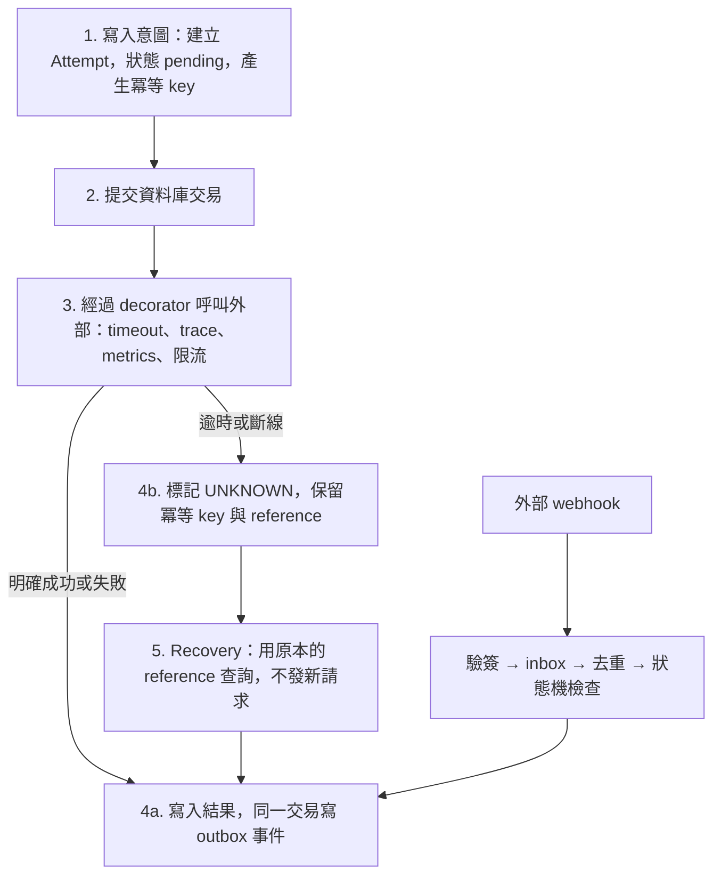
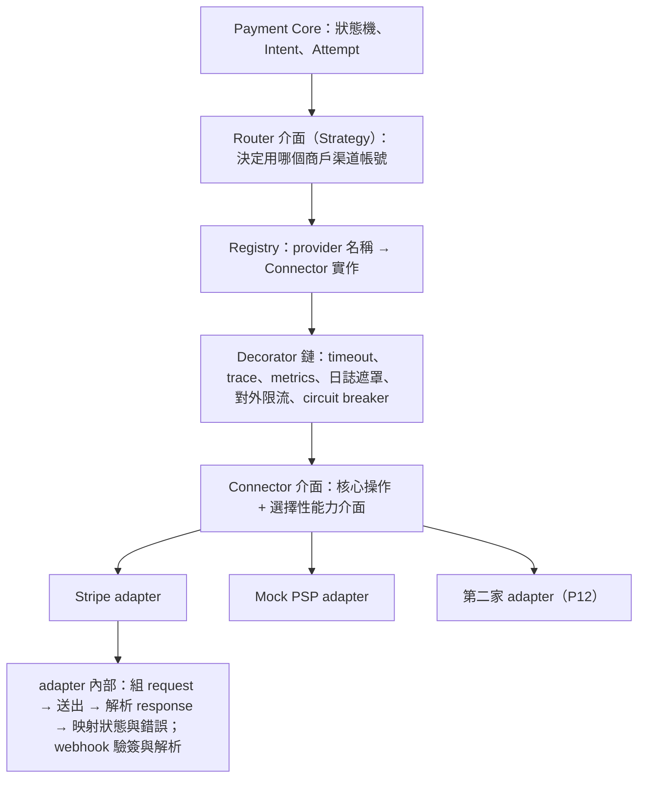

# 系統設計模式：解決什麼、在哪次迭代學、何時不要用

這份文件把整個計劃會用到的系統設計模式集中起來。階段文件裡，重要的迭代會多一行 **設計模式**，指回這裡。

使用方式：

- **先有問題，再用模式。** 每個模式都寫了「在付款系統解決什麼」。如果你說不出這次迭代的問題，就先不要套模式。
- **第一次出現時要寫筆記。** 在學習筆記裡用自己的話寫：這個模式解決什麼、代價是什麼、這次為什麼值得付這個代價。
- **「何時不要用」和「何時要用」一樣重要。** 面試時能說出不用的理由，比背出模式名稱更有說服力。

---

## 1. 最常重複的組合：一次安全的外部呼叫

付款系統裡大部分的錯誤都發生在「呼叫外部」這一步（PSP、銀行、KYC vendor）。下面這個組合會在 P02、P03、P04、P07、P08、P12 重複出現，值得先記住整體形狀：

| 步驟 | 模式 | 第一次出現 |
|---|---|---|
| 1–2 | 先寫意圖、外部呼叫不放在資料庫交易裡 | I-02.07 |
| 1 | 冪等 key（呼叫端產生，綁 Attempt） | I-03.04 |
| 3 | Decorator | I-03.06a |
| 4a | Transactional outbox | I-03.11 |
| 4b | 逾時即未知 | I-03.06 |
| 5 | 先查再做（query-then-act） | I-03.07 |
| webhook | 驗簽、Inbox、狀態機 | I-03.08–03.10、I-02.03 |

之後每次遇到新的外部依賴，先問自己：這六步每一步在這裡長什麼樣子？哪一步可以省略、為什麼？

---

## 2. PSP 抽象的分層

真實平台不會只接一家 PSP，所以 Connector 的抽象從 P02 就要以「多家」為前提設計，即使第二家在 P12 才真的接入。

| 層 | 負責 | 不負責 | 建立於 |
|---|---|---|---|
| Payment Core | 狀態轉移、冪等、何時可以建新 Attempt | 任何 PSP 名稱、格式、錯誤碼 | P02 |
| Router | 依規則選出一個商戶渠道帳號 | 怎麼呼叫該 PSP | I-02.05b 建立固定路由；I-12.04 換成規則路由 |
| Registry | 依 provider 找到 Connector 實作 | 選擇哪一家 | I-02.05b |
| Decorator 鏈 | 每家 PSP 都需要的橫切邏輯 | 業務判斷、重試付款 | I-03.06a；I-12.06 加 circuit breaker |
| Connector 介面 | 正規化的操作與結果（Succeeded、Failed、Pending、RequiresAction、Unknown） | 原始格式 | I-02.05、I-02.05a |
| Adapter | 一家 PSP 的請求、回應、錯誤、webhook 的轉換 | 狀態轉移規則 | I-02.06、I-03.05、I-12.01 |

要學的取捨：

- **核心操作與選擇性能力分開。** 每家都必須有授權、請款、取消、退款、查詢；部分請款、多次請款、增量授權、payout 是選擇性能力。不支援時要回明確錯誤，不能默默跳過（I-02.05a、I-12.03）。
- **選擇用哪家，和怎麼呼叫那家，是兩件事。** 前者是 Router（Strategy），後者是 Adapter。混在一起時，P12 加路由規則就會改到每個 adapter。
- **「每個商戶的渠道帳號」是一級概念。** 同一家 PSP 可能有多組憑證（不同商戶、test 與 live）。Attempt 要記錄用了哪一組，對帳與退款才找得到原交易（I-02.05b）。
- **所有實作跑同一套 conformance 測試。** fake、Mock PSP、Stripe（錄製回應）、第二家都必須通過同一套生命週期測試，這是「介面真的通用」的證據（I-02.13、I-12.02）。
- **不要做的抽象：** 一個 `Do(map[string]any)` 的萬用介面；每家 PSP 一個微服務（架構文件第 5.2 節）；在 Payment Core 寫 `switch provider`。

P12 開始前，讀 Hyperswitch 的 `ConnectorIntegration` 與 `merchant_connector_account`，對照你自己的分層哪裡比它簡單、哪裡少了東西。

---

## 3. 模式目錄

「第一次出現」是你第一次需要做設計決定的迭代；「之後」是同一個模式再次出現、通常更複雜的地方。

### 3.1 架構與邊界

| 模式 | 在付款系統解決什麼 | 第一次出現 | 之後 | 何時不要用 / 常見誤用 |
|---|---|---|---|---|
| Modular Monolith | 先用一個資料庫交易保證資金一致性，同時保留之後拆分的邊界 | I-00.02 | P16、P17 | 只分資料夾、不檢查 import，等於沒有邊界 |
| Ports & Adapters（六角架構） | 核心不依賴 PSP、vendor、資料庫細節，可以用 fake 測試 | I-00.02 | I-02.05、I-08.03、I-14.05 | 每個簡單 CRUD 都包三層介面，只增加檔案數 |
| Anti-corruption layer | 不讓 PSP 的模型和用語滲進核心 | I-02.05 | I-02.12、I-17.05 | 只轉換欄位名稱，卻把 PSP 的狀態語意原樣帶進來 |
| Composition root（依賴注入） | 在 `cmd/` 一個地方組裝所有依賴，測試可以替換 | I-00.07 | I-02.05b | 用全域變數或 `init()` 註冊依賴，測試無法替換 |
| Registry | 依名稱找到實作，新增 PSP 不用改核心 | I-02.05b | I-12.01 | 執行時動態載入 plugin；個人專案沒有這個需求 |
| Strangler fig | 逐步把功能從 monolith 移出，新舊並存 | I-17.01 | I-17.05 | 一次重寫整個模組 |
| Database per service | 服務獨立部署與資料所有權 | I-17.08 | — | 在 monolith 階段就拆資料庫，失去交易保證 |
| CQRS read model | 報表查詢不拖慢交易資料庫，也不跨 schema JOIN | I-15.09 | I-17.09 | 每個查詢都做 read model；先確認真的有效能或邊界問題 |

### 3.2 程式結構

| 模式 | 在付款系統解決什麼 | 第一次出現 | 之後 | 何時不要用 / 常見誤用 |
|---|---|---|---|---|
| Adapter | 把外部 API 轉成自己的介面 | I-02.06 | I-03.05、I-08.03、I-12.01、I-14.05 | adapter 裡寫業務規則（例如決定能不能退款） |
| Capability interface（介面分離） | 不同 PSP 能力不同，核心要能詢問「支不支援」 | I-02.05a | I-12.03 | 為每個方法各拆一個介面，呼叫端到處型別斷言 |
| Strategy | 同一個決策有多種演算法：路由、費率、比對規則、重試策略 | I-02.05b | I-06.11、I-12.04、I-13.08 | 只有一種演算法時就先抽象 |
| Decorator | timeout、trace、metrics、限流、斷路，對每家 PSP 一致 | I-03.06a | I-12.06 | 把「重試付款」做成通用 decorator，對非冪等操作很危險 |
| Middleware chain | HTTP 層的驗證、request_id、限流、日誌 | I-00.07 | I-01.03、I-01.06、I-01.11 | middleware 裡做業務判斷 |
| Value object | 金額與幣別一起出現、不可變、自帶驗證 | I-01.09 | I-14.07 | 用 `float64` 或只傳整數不帶幣別 |
| Repository 與交易邊界 | 業務邏輯不直接寫 SQL；同一個交易內寫狀態和 outbox | I-02.01 | I-03.11 | repository 自己開交易，導致無法和 outbox 放在同一個交易 |
| 表驅動狀態機 | 擋下亂序、重複、非法的狀態轉移 | I-02.03 | I-04.01、I-07.01、I-08.01、I-13.04、I-14.01 | 用分散的 if/else 判斷狀態 |
| 規則引擎 / Specification | 規則可以組合、版本化、稽核 | I-10.02 | I-06.05–06.07、I-12.04 | 自己做一個圖靈完備的 DSL |
| Pipeline | 檔案匯入分成解析、正規化、驗證、寫入，每步可單獨測試與重跑 | I-06.03 | I-06.13 | 一個函式從讀檔做到寫帳 |

### 3.3 一致性與併發

| 模式 | 在付款系統解決什麼 | 第一次出現 | 之後 | 何時不要用 / 常見誤用 |
|---|---|---|---|---|
| Idempotency key | 商戶重送、我們重送給 PSP，都不會重複扣款 | I-03.01 | I-03.04、I-04.04、I-07.04 | 每次重試產生新 key；或 key 不綁定請求內容 |
| Idempotent consumer（Inbox） | at-least-once 的事件與 webhook 不造成重複效果 | I-03.09 | I-05.05、I-08.05、I-09.05 | 只靠 broker 的「exactly-once」宣稱 |
| Transactional outbox | 狀態已提交但事件沒發出去 | I-03.11 | I-09.04 | 先寫資料庫再直接發 broker，中間當機就遺失 |
| 樂觀鎖 | 衝突少時的併發更新（capture 與 void 同時到） | I-02.04 | I-04.03 | 衝突很多的熱點資料，重試成本反而更高 |
| 悲觀鎖 / 條件更新 | 餘額不能被重複使用 | I-05.11 | I-07.03 | 在應用程式先讀再判斷再寫 |
| Reservation（Hold） | 送出到確認之間先鎖住資金 | I-05.10 | I-07.03、I-17.10 | hold 自動過期釋放，但外部其實已成功 |
| 沖銷分錄（補償） | 已入帳的錯誤不修改，而是加一筆反向分錄 | I-05.04 | I-06.09、I-14.04 | 直接 UPDATE 已過帳的分錄 |
| Saga / Process manager | 跨多步驟、有外部呼叫的流程，失敗時要有補償 | I-07.03 | I-07.06、I-17.10 | 用分散式交易（2PC）硬做 |
| Append-only | 帳本與稽核紀錄可以被追查 | I-05.04 | I-15.08 | 允許「只修一下」的管理員 UPDATE |
| Snapshot + 增量 | 餘額不用每次從第一筆分錄加總 | I-05.08 | I-05.11a、I-14.06 | snapshot 與分錄不在同一交易更新，產生漂移 |
| Effective-dated records | 費率、匯率、規則變更後，舊交易仍用當時的值 | I-06.11 | I-10.07、I-14.06 | 直接覆蓋設定，事後無法重算 |

### 3.4 可靠性與流量

| 模式 | 在付款系統解決什麼 | 第一次出現 | 之後 | 何時不要用 / 常見誤用 |
|---|---|---|---|---|
| 逾時即未知 | PSP 可能已扣款但回應遺失 | I-03.06 | I-04.05、I-07.05、I-17.06 | 逾時就標記失敗並重試 |
| 先查再做（query-then-act） | 未知結果用原本的 reference 收斂 | I-03.07 | I-04.05、I-07.05 | 查不到就立刻判定失敗 |
| 退避重試與 jitter | 暫時性錯誤不要一起重試，打垮下游 | I-03.07 | I-09.06、I-13.08 | 對 hard decline 或非冪等操作重試 |
| Retry budget 與 deadline 傳遞 | 多層重試不會讓請求數相乘 | I-17.06 | — | 每一層都各自重試三次 |
| Circuit breaker | 不持續打已經故障的 PSP | I-12.06 | — | 把 UNKNOWN 交易改送另一家的理由 |
| Bulkhead | 一個慢的商戶端點或 PSP 不會耗盡所有 worker 與連線 | I-09.05 | I-16.09（壓測時觀察連線池與 worker 池） | 所有工作共用一個無上限的 goroutine 池 |
| Rate limiting | 入站保護自己，出站遵守 PSP 限制 | I-01.11 | I-03.06a | 沒想清楚 Redis 故障時要放行還是拒絕 |
| Competing consumers（`SKIP LOCKED`） | 多個 worker 安全地分工 | I-03.07 | I-03.12、I-09.05 | 用應用程式層的鎖或 Redis 鎖保護資金操作 |
| 單一執行者排程 | 排程 job 多實例時不重複執行 | I-02.11 | I-13.07 | 以「只部署一個實例」當作保證 |
| DLQ 與 replay | 失敗的訊息不遺失、可以人工重送 | I-09.06 | I-09.07 | DLQ 沒人看、沒有告警 |
| 安全 failover | 渠道故障時換一家，但不造成雙重扣款 | I-12.08 | — | 結果未知時 failover |
| 優雅關閉 | 部署時不中斷進行中的請求與 job | I-00.07 | I-03.12 | 只處理 HTTP，忘了 worker |
| Backpressure / load shedding | 超過容量時有控制地拒絕，而不是全部變慢 | I-16.09 | — | 無上限的佇列 |
| Health check | 區分「行程活著」與「能處理請求」 | I-00.07 | I-12.05 | readiness 檢查所有下游，一個依賴故障就全部下線 |

### 3.5 資料與擴展

| 模式 | 在付款系統解決什麼 | 第一次出現 | 之後 | 何時不要用 / 常見誤用 |
|---|---|---|---|---|
| Cache-aside 與失效 | API key 驗證不用每次查資料庫 | I-01.03 | — | 撤銷後快取仍有效，造成安全漏洞 |
| Sharded counter（熱點帳戶） | 平台收入帳戶不會成為所有交易的鎖點 | I-05.11a | — | 需要即時預留的帳戶也拆開，失去超額保護 |
| 事件 schema 版本 | 對外事件演進時不破壞商戶 | I-09.01 | I-17.02 | 直接改欄位語意 |
| Partitioning 與封存 | 大表的維護與查詢成本 | I-16.06 | — | 資料量還很小就分區 |
| Expand / contract | 不停機的 schema 與資料遷移 | I-17.03 | I-17.08 | 同一次部署同時改 schema 與程式 |
| Event-carried state transfer | 服務用事件建立自己需要的資料副本 | I-17.09 | — | 副本被當成可寫的事實來源 |
| Shadow mode | 新規則先觀察、不生效 | I-10.07 | I-12.04 | shadow 結果沒有被比較與檢視 |

### 3.6 安全

| 模式 | 在付款系統解決什麼 | 第一次出現 | 之後 | 何時不要用 / 常見誤用 |
|---|---|---|---|---|
| Tokenization | 伺服器不接觸卡號，縮小 PCI 範圍 | I-02.07 | I-11.06 | 日誌或錯誤訊息裡出現原始卡資料 |
| HMAC 簽章 + 時間戳 | 驗證 webhook 來源，防重放 | I-03.08 | I-09.03 | 用一般字串比較；不檢查時間窗 |
| Fail closed | 結果不確定時不放行 | I-08.03 | I-08.08、I-10.01 | 所有依賴都 fail closed，一個 vendor 故障就全站停擺；要分清楚哪些可以降級 |
| Maker-checker | 高風險操作需要第二人核准 | I-06.09 | I-07.07、I-15.07 | 同一個人可以自己核准 |
| Envelope encryption | 個資欄位加密，金鑰可輪替 | I-16.02 | — | 金鑰和資料放在同一個地方 |
| Least privilege | 模組或服務只能寫自己的資料 | I-16.04 | I-17.08 | 所有模組共用 superuser 連線 |
| Hash chain | 稽核紀錄被改動可以被發現 | I-15.08 | — | 只靠「沒有提供刪除 API」 |

### 3.7 測試

| 模式 | 在付款系統解決什麼 | 第一次出現 | 之後 | 何時不要用 / 常見誤用 |
|---|---|---|---|---|
| Fake 與 Mock 的區分 | fake 有真實行為可以跑流程；mock 只驗證呼叫 | I-00.08 | I-02.05 | 用 mock 驗證每個呼叫順序，重構時測試全壞 |
| Clock 注入 | 授權過期、時間窗、計費週期可以被測試 | I-00.08 | I-02.11、I-06.06、I-13.11 | 程式到處直接呼叫 `time.Now()` |
| 錄製回應的契約測試 | CI 不連外部，也能抓到解析錯誤 | I-02.13 | I-12.02 | fixtures 含有 secret |
| Conformance suite | 每個 Connector 實作都符合同一份行為規格 | I-02.13 | I-03.05、I-12.02 | 每個 adapter 各寫各的測試，行為不一致也沒發現 |
| Consumer-driven contract | 服務之間的契約不被單方面破壞 | I-17.11 | — | monolith 階段就導入 |
| Fault injection | 故障可以按需重現 | I-03.05 | I-16.08、I-17.12 | Mock 比真實 PSP 更理想，測不到問題 |
| Property-based test | 用隨機資料驗證不變量（帳永遠平衡） | I-05.12 | — | 只用來測簡單函式 |

---

## 4. 刻意不用的模式

| 模式 | 為什麼不用 | 什麼情況下才考慮 |
|---|---|---|
| 分散式交易（2PC、XA） | 架構文件第 9 節的決定：本地交易 + outbox / inbox + 冪等 + 對帳 | 幾乎不會；寫在 ADR 裡說明理由即可 |
| 完整 Event Sourcing | 帳本已是 append-only；付款狀態用狀態機加歷史表就夠，完整 ES 會讓查詢與 schema 演進變難 | 需要任意時間點重建所有聚合，且團隊熟悉 ES |
| Redis 分散式鎖保護資金 | 鎖可能因逾時或故障失效；資金正確性應該由資料庫約束或列鎖保證 | 只用於「重複執行也不會出錯」的優化，例如減少重複工作 |
| 通用重試 decorator | 對非冪等的付款操作重試等於重複扣款 | 只對查詢類、或帶同一冪等 key 的操作 |
| 每家 PSP 一個微服務 | 架構文件第 5.2 節：先用單一 connector 加多個 adapter | 某一家有獨立的流量、隔離或合規需求 |
| Service mesh | 個人專案的服務數量不需要 | 服務數量多、需要統一的 mTLS 與流量政策 |

---

## 5. 面試時怎麼講一個模式

用四句話：

1. **問題**：付款系統裡這裡會出什麼錯（例如逾時後重送造成重複扣款）。
2. **模式**：我用了什麼（Attempt 級冪等 key，加上逾時即未知與先查再做）。
3. **代價**：它帶來什麼成本（UNKNOWN 狀態要有 recovery 與人工處理流程）。
4. **證據**：怎麼證明有效（故障場景、重跑指令、trace）。

只講模式名稱、說不出代價與證據，通常會被追問到答不出來。
